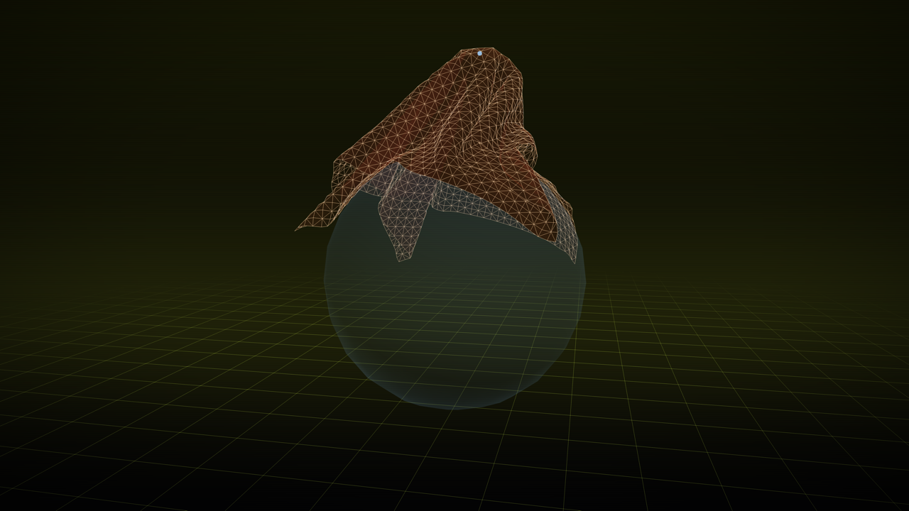
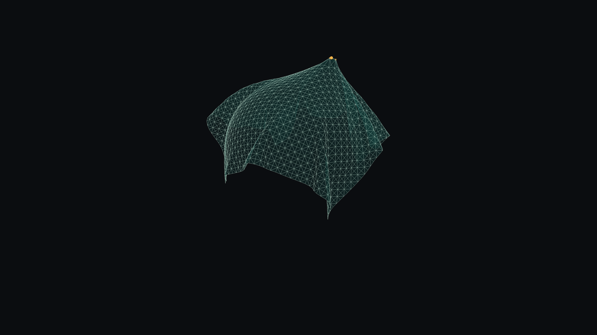
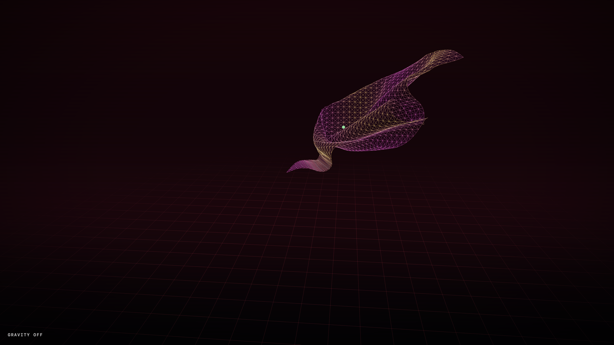
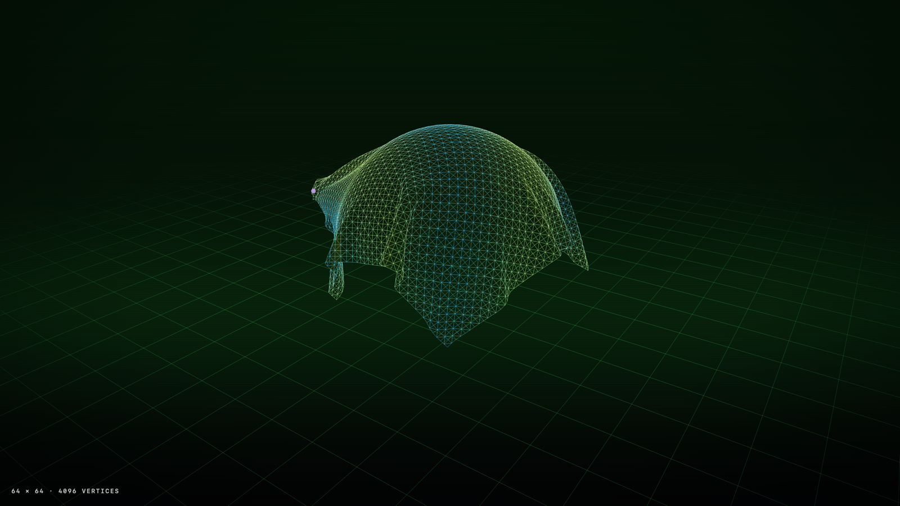

# ClothMesh

A real-time wireframe cloth you can grab and fling, draped over an invisible ball. Native macOS, Swift + Metal, with a custom CPU XPBD cloth solver and no third-party dependencies. It also plays a scripted demoscene-style demo with its own procedurally synthesized 120 BPM soundtrack.

Inspired by a half-remembered 2003 toy by Russ (Armitage, Beyond group) on his Mac: a mesh net you could grab and fling.

[](https://youtu.be/7Vdcy3ydwD8)

▶️ **[Watch the demo on YouTube](https://youtu.be/7Vdcy3ydwD8)**

## Screenshots

| Grab and drag | Demo: zero gravity | Demo: 64 × 64 net |
|---|---|---|
|  |  |  |

## Features

- **XPBD cloth**: structural, shear and bend distance constraints; fixed 120 Hz substeps; 8 solver iterations by default.
- **Invisible sphere collider** with static and kinetic friction, so the sheet stays draped and slides when pulled.
- **Self-collision** through a spatial hash, so the net can fold over itself without passing through.
- **Grab anything**: ray-cast against the triangles picks the exact spot. The pointer drags it on a camera-facing plane, and releasing keeps the velocity so you can fling the cloth.
- **Metal renderer**: translucent fill plus a wireframe of unique edges, 4× MSAA. No mesh shaders; the renderer is deliberately simple.
- **Demo mode (D)**: a 76 s choreography of camera moves, scripted "hands", gravity and wind changes, and glowing wires. It's synced to a live-synthesized trance/chiptune track.

## Requirements

- macOS 14 Sonoma or later, Apple Silicon
- Xcode 16 or later, with the Metal Toolchain component. If a build says it's missing, run `xcodebuild -downloadComponent MetalToolchain`.

## Build and run

Open `ClothMesh/ClothMesh.xcodeproj` and press ⌘R, or:

```bash
cd ClothMesh
xcodebuild -scheme ClothMesh -configuration Release -derivedDataPath build/DerivedData build
open build/DerivedData/Build/Products/Release/ClothMesh.app
```

The Debug configuration also compiles Swift with `-O`: the CPU solver is roughly 30× slower unoptimized.

## Controls

| Action | Input |
|---|---|
| Grab and drag the cloth | Left mouse / trackpad click-drag |
| Orbit | Right-drag, two-finger scroll, or left-drag on empty space |
| Pan | ⌥ + left-drag or middle-drag |
| Zoom | Mouse wheel or pinch |
| Reset (re-drape) | R |
| Pause / play | Space |
| Show the collider | C |
| Toggle the fill (wire-only) | W |
| Play the demo (stop: D or Esc) | D |

The bottom HUD has the same toggles plus sliders for grid resolution (16–80), gravity, stiffness, damping and solver iterations. It also shows FPS.

## Demo and soundtrack

Press **D** to play the demo. The music is synthesized live by [`Soundtrack.swift`](ClothMesh/ClothMesh/Soundtrack.swift):
- A minor, i–VI–III–VII
- Four-on-the-floor kick, rolling offbeat bass, square-wave arpeggio with a dotted-eighth ping-pong echo
- Sidechained saw pads, a saw lead, snare rolls and risers

The audio playback position is the demo's master clock, so scene changes, grabs and flashes land on the beat.

Tools to export the soundtrack and render the video offline, starting from the `ClothMesh/` folder:

```bash
# Soundtrack → Soundtrack/ClothMesh-soundtrack.wav + .mid (multi-track MIDI)
swiftc -O -o /tmp/export-soundtrack ClothMesh/Soundtrack.swift Tools/ExportSoundtrack/main.swift
/tmp/export-soundtrack Soundtrack

# Demo → 4K 60 fps MP4 with the soundtrack (needs ffmpeg), plus README stills
swiftc -O -o /tmp/render-demo-video $(ls ClothMesh/*.swift | grep -v ClothMeshApp.swift) Tools/RenderDemoVideo/main.swift
/tmp/render-demo-video --metallib build/DerivedData/Build/Products/Release/ClothMesh.app/Contents/Resources/default.metallib \
    --audio Soundtrack/ClothMesh-soundtrack.wav --out ClothMesh-demo.mp4 --stills docs
```

The offline render simulates each frame at exactly `t = frame / 60`, so picture and sound are sample-accurate.

## How it works

| File | Role |
|---|---|
| `ClothSim.swift` | XPBD step: predict, distance constraints, grab constraints, self-collision, sphere and floor contacts with friction, velocity update |
| `ClothMesh.swift` | Grid, triangles, unique wire edges, springs, normals, drape warm-up (180 quiet steps before the first frame) |
| `Raycast.swift` / `GrabController.swift` | Möller–Trumbore picking with an 8 px nearest-vertex fallback, and the drag plane |
| `Renderer.swift` / `Shaders.metal` | Metal passes: background, floor grid, fill, wires, collider, grab gizmo, post (vignette, scanlines, fades, flashes) |
| `Camera.swift` / `Math.swift` | Orbit camera, projection, screen-to-world rays |
| `DemoDirector.swift` | The demo script: keyframed camera and colors, timed cues, scripted grabs |
| `Soundtrack.swift` / `SoundtrackPlayer.swift` | Arrangement, synth, and AVAudioEngine playback with a smooth audio clock |

Notes on the physics:
- The sheet is 1.6 m across; the ball's radius is 0.55 m.
- Contact friction is higher than a textbook μ = 0.25. A sheet this size only covers the top of the ball, and with low friction any off-center landing slowly creeps off.
- Self-collision keeps non-adjacent particles at least 0.9 grid spacings apart, pushing each pair apart along the direction they had in the previous substep. It also caps how far a particle can move per substep, so layers can't tunnel through each other.

The original design spec is in [`Mesh-macOS-spec.md`](Mesh-macOS-spec.md).

## License

[MIT](LICENSE) © 2026 Roman Gorshunov
